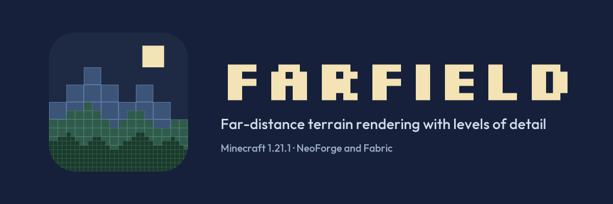

# Farfield

Far-distance terrain rendering for Minecraft, using levels of detail (LOD):
the terrain beyond your render distance, up to 4,096 blocks away, at a
fraction of the cost of real chunks.

Status: 0.2.0, early. Minecraft 1.21.1, NeoForge and Fabric. What it does
today, its requirements and what is planned: [`docs/listing/description.md`](docs/listing/description.md)
(the text of the Modrinth and CurseForge pages).

- Vision: [`docs/VISION.md`](docs/VISION.md)
- Decisions: [`docs/DECISIONS.md`](docs/DECISIONS.md)
- Current plan: [`docs/plans/milestone-2.md`](docs/plans/milestone-2.md)
- State of the art: [`docs/analysis/lod-engine-state-of-the-art.md`](docs/analysis/lod-engine-state-of-the-art.md)

## Building

Requires a JDK to launch Gradle; Java 21 is provisioned automatically.

```
./gradlew build
```

Jars: `neoforge/build/libs/` and `fabric/build/libs/`.

## Brand

Logo source `docs/brand/farfield-logo.svg`, banners and their render
scripts in `docs/brand/` (fonts: Silkscreen and Outfit, SIL Open Font
License, in `docs/brand/fonts/`).

## License

GNU Lesser General Public License v3.0 only (`LICENSE`), which supplements
the GNU General Public License v3.0 (`COPYING`); ADR-067. Copyright (C)
2026 Lakio.
