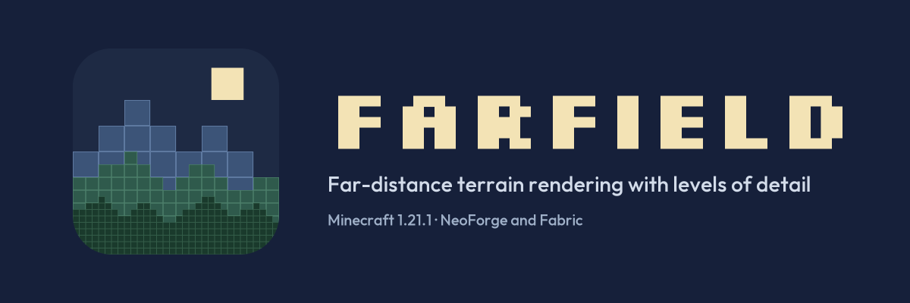

# Farfield

Far-distance terrain rendering for Minecraft, using levels of detail (LOD):
the terrain beyond your render distance, 4,096 blocks by default and out to
the world border, at a fraction of the cost of real chunks.

Status: 1.2.1, one source tree for every Minecraft version and loader
(ADR-165). What it does today, its requirements and what is planned:
[`docs/listing/description.md`](docs/listing/description.md) (the text of the
Modrinth and CurseForge pages).

| Minecraft | Loaders |
|---|---|
| 1.20.1 | Forge 47 (its jar also loads on NeoForge 47.1), Fabric |
| 1.21.1, 1.21.11 | NeoForge, Fabric |
| 26.1.2, 26.2, 26.3 | NeoForge, Fabric |

- Vision: [`docs/VISION.md`](docs/VISION.md)
- Decisions: [`docs/DECISIONS.md`](docs/DECISIONS.md)
- Current plan: [`docs/plans/milestone-2.md`](docs/plans/milestone-2.md)
- State of the art: [`docs/analysis/lod-engine-state-of-the-art.md`](docs/analysis/lod-engine-state-of-the-art.md)

## Building

Requires a JDK to launch Gradle; the JDKs the build needs (17, 21 and 25) are
provisioned automatically.

```
./gradlew build
```

Jars: `neoforge/build/libs/`, `fabric/build/libs/` and `forge/build/libs/`, one
per loader and Minecraft version.

## Brand

Logo source `docs/brand/farfield-logo.svg`, banners and their render
scripts in `docs/brand/` (fonts: Silkscreen and Outfit, SIL Open Font
License, in `docs/brand/fonts/`).

## License

GNU Lesser General Public License v3.0 only (`LICENSE`), which supplements
the GNU General Public License v3.0 (`COPYING`); ADR-067. Copyright (C)
2026 Lakio.
